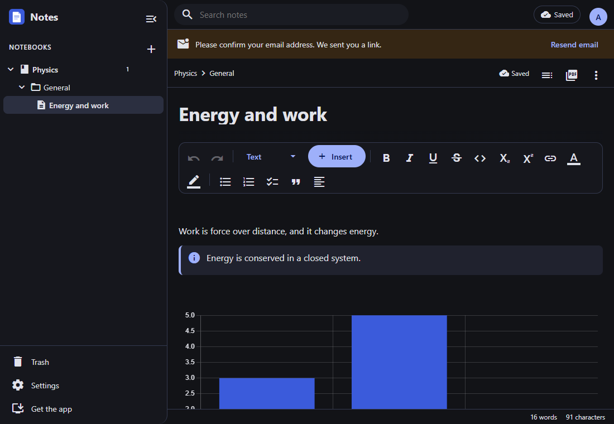
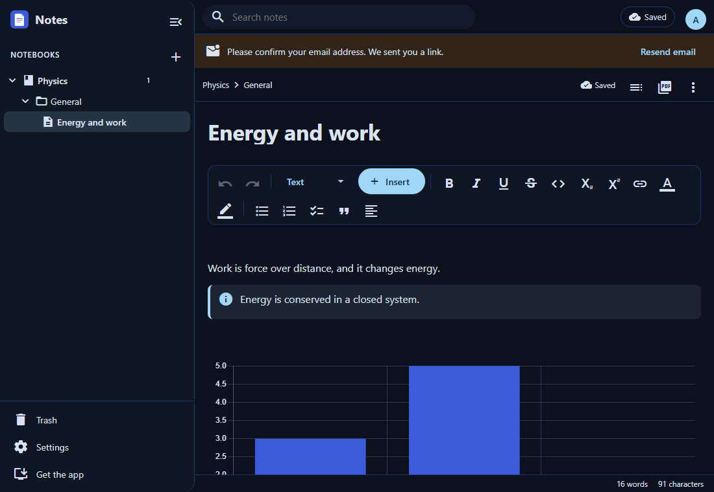

# OS_Planner

OS_Planner is an open source, self-hosted planner: a website with notebooks, categories and pages, a rich editor (math,
diagrams, charts, function plots, code, images, video), PDF export, offline editing with sync, accounts, and teams with
projects, live updates and team chat. It runs in the browser, installs as a PWA, and is downloadable as a desktop app for Windows and Linux, **all from the website**.

```
notebook ─ category ─ nested category ─ page        every level has its own name; reorder, move, trash, restore
```

## What is in the box

| Part | What it is |
| --- | --- |
| `apps/server` | NestJS 12 + Prisma 7 + **MySQL 8.4**. Auth, notebooks/categories/pages, sync, media, search, PDF/Markdown export, release downloads, the live connection (Socket.IO) and chat. Also serves the website. |
| `apps/web` | Angular 22 PWA (zoneless, signals, Material 3). Local-first: everything reads from IndexedDB and syncs in the background. English + Portuguese. |
| `apps/desktop` | Electron shell: a native window around the website (always up to date). Windows installer/portable, Linux AppImage/deb/rpm. |
| `packages/shared` | The document schema, validation, Markdown import/export, print renderer, plot engine and DTOs used by all of the above. |

## Architecture

```
 browser / PWA / desktop window (Angular)                         one server process (NestJS), any number of them
 ┌────────────────────────────────────────┐   https  /api/...   ┌──────────────────────────────────────────────┐
 │ IndexedDB (Dexie): notes, boards,      │ ◄────────────────► │ REST: auth, tree, sync, chat, boards, calendar │──► MySQL 8.4
 │ calendar, outbox, Local history        │   wss /api/realtime │ Socket.IO: presence, rooms, live events       │    (everything)
 │ Yjs documents of open pages            │ ◄────────────────► │ Hocuspocus: co-edited pages (Yjs)             │──► DATA_DIR
 │ service worker: the app offline        │   wss /api/collab   │ jobs: reminders, digests, feeds, clean-up     │    (files)
 └────────────────────────────────────────┘                     └──────────────────────────────────────────────┘
        ▲  WebRTC (audio, video)                                     │ optional            │ optional
        └──────────────────────────► LiveKit (voice channels) ◄──────┘ webhooks            └──► Redis (several instances)
```

- **Everything belongs to a space**: a person's own, a team's, or a project's. A space has a change counter; each write takes the next number
  under a row lock, so "everything after N" is exact and ordered. Devices keep one cursor per space (`GET /api/sync/changes?cursors=…`).
- **Local first.** The website reads from IndexedDB and writes there first; an outbox sends the changes (`POST /api/sync/batch`), merged field
  by field on the server (what loses goes to the device's Local history). Page texts are Yjs documents, merged without conflicts.
- **Permissions** are a bit field computed by one shared engine (`packages/shared/src/permissions`), on the server for every request and in the
  website to hide what cannot be done. See "Permissions at a glance".
- **Events** go out through an internal bus to Socket.IO rooms (`user:`, `team:`, `space:`, `channel:`, `thread:`, `board:`); a client joins a
  room only after the same permission check, and leaves it when its permissions change. With `REDIS_URL` the rooms and the co-editing
  sessions are shared between instances.
- **Every route declares who may call it** (`@Authz` in `apps/server/src/common/authz.ts`), and a generated test runs each route as ten kinds of
  people (see "Tests" and `phases/security-review.md`).

### Why the document format is not Markdown

Pages are stored as **ProseMirror/TipTap JSON**, validated against one shared schema. Markdown cannot represent
charts, diagrams, video, image size/alignment/captions, colour or complex tables without HTML hacks, and a
save would round-trip through a parser and drift. JSON is lossless and schema-checked (no raw HTML, so no stored
XSS). Markdown stays as an interchange format: import, and export of a page (`.md`) or a notebook (`.zip` with folders).

## Run it (development)

Requirements: Node 22+ (developed on 24), Docker, Google Chrome or Edge (for PDF export).

```bash
cp .env.example .env              # then set JWT_ACCESS_SECRET / JWT_MEDIA_SECRET (>= 32 chars)
docker compose up -d mysql mailpit
npm install
npm run build -w @os-planner/shared
npm run prisma:migrate -w @os-planner/server

npm run start:dev -w @os-planner/server      # API on :3000
npm run start -w @os-planner/web             # website on :4200, proxies /api to :3000
```

Verification and password-reset emails land in Mailpit: <http://localhost:8025>.
To use one origin like production, build the web app and set `WEB_DIST_DIR=apps/web/dist/web/browser`; the server then serves it at `/`.

## Run it (production, Docker)

```bash
# .env: APP_URL=https://planner.example.com, JWT_ACCESS_SECRET, JWT_MEDIA_SECRET, MYSQL_PASSWORD, SMTP_*, RELEASE_TOKEN
docker compose --profile prod up -d --build
```

One image contains the API, the website and Chromium (PDF export); migrations run on start. Put it behind a
TLS-terminating reverse proxy (an nginx config is included, see below) and set `TRUST_PROXY=true`. Data (uploads, installers) lives in the `notes-data` volume.
The server's port is published on `127.0.0.1` only (`SERVER_BIND` changes that), so nothing is reachable over plain http from the network by default.
The bundled `mailpit` is a development mail catcher: configure `SMTP_*` for real email.

### Compose profiles

`docker-compose.yml` uses profiles to decide which services start. A service without a profile always starts; a service with one
starts only when you ask for that profile with `--profile <name>` (repeat the flag to combine them).

| Profile | Services | What it is for | Command |
| --- | --- | --- | --- |
| *(none)* | `mysql`, `mailpit` | **Development.** Just the database and the mail catcher; you run the server and the website yourself with `npm run start:dev` / `npm start`. | `docker compose up -d mysql mailpit` |
| `prod` | adds `server` | **Production.** Builds and runs the one image with the API, the website and PDF export, next to MySQL. It is reachable on `127.0.0.1:3000` only (see `SERVER_BIND`). Requires `APP_URL`, `JWT_ACCESS_SECRET` and `JWT_MEDIA_SECRET`. | `docker compose --profile prod up -d --build` |
| `proxy` | adds `proxy` (nginx) | **HTTPS in front of the server.** Terminates TLS on ports 80/443 and forwards to `server`. It needs the `server` service, so always combine it with `prod`; it also needs `OS_PLANNER_DOMAIN` and a certificate. | `docker compose --profile prod --profile proxy up -d --build` |
| `voice` | adds `livekit` | **Voice and video channels.** A LiveKit media server (7880/tcp signalling, 7881/tcp and 7882/udp media). Needs `LIVEKIT_API_KEY` and `LIVEKIT_API_SECRET` (and the same three `LIVEKIT_*` settings on the server); see "Voice and video". | `docker compose --profile voice up -d livekit` |
| `scale` | adds `redis` | **Several server instances.** A Redis the instances share so live events reach people connected to any of them; set `REDIS_URL=redis://redis:6379` on each. One instance needs none. | `docker compose --profile scale up -d redis` |

Notes: `mailpit` has no profile, so it also runs in production unless you stop it (`docker compose stop mailpit`) and set
real `SMTP_*` values. Use the same `--profile` flags for every later command on the stack, for example
`docker compose --profile prod --profile proxy logs -f proxy` or `... down`; without them Compose does not see the profiled services.

### HTTPS reverse proxy (nginx)

`deploy/nginx/os-planner.conf.template` redirects http to https, terminates TLS (1.2/1.3, HTTP/2), forwards the real client address,
streams large uploads (`client_max_body_size 1g`, above `MAX_VIDEO_MB` and the biggest installer), compresses text, waits up to
3 minutes for PDF export, and passes WebSocket upgrades for the live connection (`/api/realtime`, Socket.IO; `/api/collab`, the co-editing WebSocket).
`os-planner-voice.conf.template` (mounted next to it) forwards the media server's own host name (`OS_PLANNER_LIVEKIT_DOMAIN`) to LiveKit's signalling port, see "Voice and video"; the audio and video themselves cannot pass through nginx. It does not repeat the headers the server sets itself (HSTS, CSP). A request for any other host name is dropped. Share links need nothing extra: `/s/<token>` is a page of the app and `/api/links/…` an API route, both already forwarded; calendar feeds (`/api/feeds/<secret>.ics`, fetched by Google, Outlook or Apple Calendar without signing in) have their own `location` that keeps the secret out of the access log; keep `TRUST_PROXY=true` so the wrong-password limit counts real client addresses, not the proxy's.

**With Docker** (nginx runs next to the server):

```bash
# .env
OS_PLANNER_DOMAIN=planner.example.com
APP_URL=https://planner.example.com
TRUST_PROXY=true
# certificate: put fullchain.pem and privkey.pem in ./deploy/certs (or point TLS_CERT_DIR at the folder, e.g. /etc/letsencrypt/live/planner.example.com)

docker compose --profile prod --profile proxy up -d --build
```

Certificate from Let's Encrypt (the proxy serves `/.well-known/acme-challenge/` from `ACME_DIR`, default `./deploy/acme`):

```bash
certbot certonly --webroot -w ./deploy/acme -d planner.example.com     # or: --standalone, before the proxy first starts
# TLS_CERT_DIR=/etc/letsencrypt/live/planner.example.com   (and reload nginx after renewals: docker compose exec proxy nginx -s reload)
```

A throwaway self-signed certificate for trying it out:

```bash
mkdir -p deploy/certs && openssl req -x509 -newkey rsa:2048 -nodes -days 30 -keyout deploy/certs/privkey.pem \
  -out deploy/certs/fullchain.pem -subj "/CN=planner.example.com" -addext "subjectAltName=DNS:planner.example.com"
```

**With nginx on the host** (no Docker proxy): fill in the template and reload.

```bash
OS_PLANNER_DOMAIN=planner.example.com OS_PLANNER_UPSTREAM=127.0.0.1:3000 \
  envsubst '${OS_PLANNER_DOMAIN} ${OS_PLANNER_UPSTREAM}' < deploy/nginx/os-planner.conf.template | sudo tee /etc/nginx/conf.d/os-planner.conf
# then point ssl_certificate / ssl_certificate_key (and the acme-challenge root) in that file at your own paths, and: sudo nginx -t && sudo nginx -s reload
```

Behind this proxy: `APP_URL` is the https address, `TRUST_PROXY=true` (rate limits and logs then see the real client address, not the proxy's),
`CORS_ORIGINS` only if the website is on another origin. If you serve the API from its own host name, give it a second
`server` block (copy the 443 one) and set `OS_PLANNER_API_URL`/`CORS_ORIGINS` as described below.

### Configuration

Every setting, with its default and what it does, is in **[docs/configuration.md](docs/configuration.md)**, generated from the server's
own schema (`apps/server/src/config/env.ts`; `node scripts/env-doc.mjs` rewrites it, and a test fails when it is out of date). The ones every
install sets: `APP_URL`, `DATABASE_URL` (in Docker: `MYSQL_PASSWORD`), `JWT_ACCESS_SECRET`, `JWT_MEDIA_SECRET`, `SMTP_*`, `ADMIN_EMAILS`;
behind a proxy `TRUST_PROXY=true`. `.env.example` has a commented example of each group.

### Running it: logs, health, metrics

- **Logs.** One JSON object per line in production (`LOG_FORMAT=json`, `text` for people), at `LOG_LEVEL` (`log` by default). Each API request
  is one line (`LOG_REQUESTS`): its id, method, path *without its query string*, status, time and who. Every answer carries `X-Request-Id`
  (the caller's own when it sends a plain one; the nginx template passes `$request_id`), so a report from a person can be found in the logs.
  Tokens, secret addresses (feeds, share links, invites), query strings and push endpoints are taken out of every log line before it is written.
- **Health.** `GET /api/health` (no login) answers 200 while the database and the storage folder work, with each part:
  `{"ok":true,"db":"ok","storage":"ok","realtime":"ok","mail":"ok"}` (+ `redis` and `livekit` when configured). Mail and the media server are
  checked at most once a minute and only reported (`degraded`): an SMTP outage must not get the container restarted. `?strict=1` also fails
  while the realtime server is down; the image's `HEALTHCHECK` uses it.
- **Metrics.** `GET /api/metrics` (Prometheus text) for instance administrators, or a scraper with `Authorization: Bearer <METRICS_TOKEN>`:
  memory, event-loop lag, active handles, requests and their durations by route, realtime connections and rooms, co-editing documents and
  store time, emails waiting, calendars due for a refresh, people in voice channels. Everybody else gets 404. A minimal Prometheus job:
  ```yaml
  - job_name: os-planner
    metrics_path: /api/metrics
    scheme: https
    authorization: { credentials: <METRICS_TOKEN> }
    static_configs: [{ targets: ['planner.example.com'] }]
  ```
- **Database.** Prisma's pool (the MariaDB driver) opens up to 10 connections per instance by default; add `?connectionLimit=20` to
  `DATABASE_URL` for a busy instance, and keep the instances × the limit under MySQL's `max_connections` (151 by default). The hot queries
  (messages of a channel, unread counts, sync by space and sequence, the calendar window, the inbox) use their indexes (`test/explain.test.ts`).
  To review slow queries: `SET GLOBAL slow_query_log = 1; SET GLOBAL long_query_time = 0.2;` and read `mysql.slow_log` / the slow log file.

### Rate limits

Per client address (behind a proxy only with `TRUST_PROXY=true`), per route, per minute; a refusal is `429` with `Retry-After`.
`RATE_LIMIT_FACTOR` multiplies all of them (`2` for a school or office where many people share one address). Each instance counts on its own.

| What | Limit / min |
| --- | --- |
| register, sign in, verify email, forgot and reset password | 10 |
| resend the verification mail | 5 |
| refresh the session | 60 |
| create invitations / open an invitation preview / accept / join a team / hand a team over | 30 / 30 / 20 / 20 / 10 |
| send a message, upload a chat or task file / start a direct conversation | 60 / 30 |
| search (notes, messages, people for a conversation) | 60 |
| upload a picture or video | 120 |
| PDF / Markdown export | 10 / 20 |
| share link: open / pages / search / files / join an edit link | 60 / 300 / 120 / 600 / 30 |
| calendar feed fetch / create or renew a feed / follow, refresh or import a calendar | 120 / 20 / 10 |
| voice: join a channel / the media server's webhook | 60 / 600 |
| everything else | 300 |

The live connection has its own limits: 5 connections per person, 100 rooms per connection, 30 events a second, 1 MB per event; co-editing
limits updates per connection, people per page and the size of a page.

### Secrets

Generate each secret with `node -e "console.log(require('crypto').randomBytes(48).toString('base64url'))"` (or `openssl rand -base64 48`).
**In production the server refuses to start** with a value of `.env.example` (`change-me…`), repeated characters, the same value for both JWT
secrets, or a default database password (`notes`, `root`, …), and says which setting to fix.

| Secret | Rotating it |
| --- | --- |
| `JWT_ACCESS_SECRET` | Restart with the new one. Open tabs lose their 15-minute access token and get a new one from their session at once: nobody is signed out. |
| `JWT_MEDIA_SECRET` | Restart. Pictures and videos already on screen keep showing; new ones ask for a new media token by themselves. |
| database password | `ALTER USER 'notes'@'%' IDENTIFIED BY '<new>';` in MySQL, then the new `MYSQL_PASSWORD` / `DATABASE_URL` and a restart. (`MYSQL_PASSWORD` only sets the password of a *new* database volume.) |
| `VAPID_PRIVATE_KEY` (+ public key) | A new pair (`npx web-push generate-vapid-keys`) invalidates every push subscription: devices subscribe again when the person next opens the site (Settings → Notifications shows it off until then). |
| `LIVEKIT_API_SECRET` | Change it in LiveKit's config and on the server together, then restart both: people in a call reconnect. |
| `RELEASE_TOKEN`, `METRICS_TOKEN` | Change and restart; update the build pipeline / the scraper. |
| a calendar feed address | Each person renews their own in Settings (calendar feeds): the old address stops at once. |
| share links, invitation links | Withdraw them (the notebook's Share dialog, team settings → Invitations) and make new ones. |
| sessions | A person ends theirs in Settings → Sessions; changing the password ends all the others. |

### Backups and restore

```bash
node scripts/backup.mjs                          # ./backups/<time>/: database.sql.gz (one consistent mysqldump) + data.tar.gz (DATA_DIR) + manifest.json
node scripts/backup.mjs --out=/srv/backups       # elsewhere; --no-docker uses a mysqldump on this machine instead of the compose "mysql" service

docker compose --profile prod stop server        # restore: stop the server first
node scripts/restore.mjs backups/2026-11-27T171500Z --yes     # replaces the database and DATA_DIR, then runs the migrations
docker compose --profile prod start server
```

Both read `DATABASE_URL` and `DATA_DIR` from the environment or `.env`. Back up the database and `DATA_DIR` together (a page refers to its
files by id), keep copies on another machine, and try a restore now and then (for example into a second database:
`node scripts/restore.mjs <folder> --yes --database-url=mysql://notes:…@localhost:3306/notes_restore_test --data-dir=/tmp/restore-test`).
A backup of an older version restores fine: the migrations bring it up to date.

### Upgrading

Back up, pull the new version, `docker compose --profile prod up -d --build` (the image runs `prisma migrate deploy` before it starts). Migrations
only move forward and keep data; they are rehearsed in the tests on a database filled by the very first version. Open tabs and desktop apps
update themselves (see "Automatic updates"). Read `CHANGELOG.md` first; for **1.0.0** in particular:

- set a real `MYSQL_PASSWORD` (and `ALTER USER` it, see "Secrets") and replace any `change-me` secret: the server refuses to start otherwise;
- requests with fields a route does not know are refused (`400`): scripts that call the API must send only documented fields;
- `PUT /api/pages/:id/content` and `GET /api/sync/changes?since=` are gone (use `snapshots/replace` and per-space `cursors`);
- the image's health check asks `/api/health?strict=1`.

### Two server instances (Redis)

1. Start Redis: `docker compose --profile scale up -d redis` (or use your own; `rediss://` for TLS).
2. Give every instance the same `.env` (same database, same secrets, same `DATA_DIR` on shared storage, e.g. NFS) and
   `REDIS_URL=redis://redis:6379`; each logs "realtime events are shared between instances through Redis" and "co-editing is shared…".
3. Put both behind one proxy that passes WebSocket upgrades: in the nginx template list both in the `upstream os_planner_app` block
   (`server 10.0.0.11:3000; server 10.0.0.12:3000;`). The live connection tries WebSocket first; a browser that has to fall back to long polling
   needs its requests to reach one instance, so add `ip_hash;` to that block.
4. Check: `/api/health` on each says `"redis":"ok"`; a message sent through one instance appears for someone connected to the other.

Rate limits and the share-link password counter are per instance (see "Rate limits").

## Pointing the website and apps at an API

By default the website calls `/api` on its own origin, which is what the Docker image gives you. If your API lives
somewhere else (say the site on `planner.example.com` and the API on `api.example.com`), tell the build:

| Build | Setting | What happens if it is not set |
| --- | --- | --- |
| Website (`npm run build -w @os-planner/web`) | `OS_PLANNER_API_URL` | You are **asked** on an interactive terminal (blank = same origin). In CI, with `CI=1` or `OS_PLANNER_NO_PROMPT=1`, or without a terminal it is not asked and the API is taken to be on the same origin. |
| Desktop app (`npm run build -w @os-planner/desktop`) | `OS_PLANNER_SERVER_URL` (the website the window opens; the site's `config.json` then says where the API is) | You are asked (default `http://localhost:3000`). |
| Docker image | `--build-arg OS_PLANNER_API_URL=…` (or `OS_PLANNER_API_URL` in `.env` for compose) | Same origin. |

The value is read from the environment, then the repo `.env`, then asked. It is written to `config.json` next to
`index.html` (`{ "apiUrl": "https://api.example.com" }`). **You can edit that file in a deployed build to repoint the site
without rebuilding.** Installed copies pick the change up on their next start (the last value is remembered for offline use).
`npm start` never asks; it uses the dev proxy (`OS_PLANNER_DEV_API_TARGET`, default `http://localhost:3000`).

On the API side, allow the website:

```bash
CORS_ORIGINS=https://planner.example.com      # exact origins, never "*"; the refresh cookie is sent with credentials
COOKIE_SAMESITE=strict                       # fine when site and API share a registrable domain (planner.example.com + api.example.com)
# COOKIE_SAMESITE=none                       # only for unrelated domains; requires an https APP_URL
```

The live connection (`/api/realtime`, Socket.IO) goes to the API's origin as well. If the website is served by a static host with its own
Content-Security-Policy, `connect-src` must list the API's `ws://`/`wss://` address next to its `http(s)://` one (the `http:` form does not cover WebSockets). With voice channels it must also list the media server's `wss://` and `https://` origin (`LIVEKIT_URL`) in `connect-src` and `media-src`.

Same-site subdomains (`strict`) are the setup to prefer: browsers are phasing out cross-site cookies, so `none` may stop working.
Images and videos from `/api/media` may be embedded by the websites named in `APP_URL` and `CORS_ORIGINS` (judged by the `Origin`/`Referer` the browser sends, which by default is the site's origin); nothing else is made embeddable.

## Desktop apps and the download page

```bash
npm run dist:win   -w @os-planner/desktop      # Windows: NSIS installer + portable .exe
npm run dist:linux -w @os-planner/desktop      # Linux AppImage/deb/rpm, built in Docker
OS_PLANNER_API_URL=https://planner.example.com RELEASE_TOKEN=... node scripts/publish-desktop.mjs   # the API address (same as the site if they share an origin)
```

Publishing uploads the files to the server; the website's **/download** page then lists them (with server-computed
SHA-256 checksums) next to the **Install as an app** (PWA) button, and installed apps update from `/downloads/`.
`OS_PLANNER_SERVER_URL` (asked for when not set) is baked into a build as the app's default website; people can change it from *File › Change server…*. Updates come from the `/downloads/` of the API named in the website's `config.json`.
On a Linux machine or in CI the Linux packages build with plain `electron-builder --linux`.

### Automatic updates

Both kinds of app update themselves without asking, and only at a moment when nothing is lost:

- **Installed website (PWA, and the page inside the desktop app).** The service worker downloads a new version in the background (checked when the app comes to the front, when the connection returns and every 30 minutes). The app switches to it (a reload) right after the person goes to another page, while the window is out of sight for 15 seconds, or after 10 minutes without input, and then shows "OS_Planner was updated." It never reloads during a voice call, with a dialog open, with an unsaved role/overwrite/channel form, while typing is still on its way to the server, or with an unsent message in a text box. A page that holds unsaved state registers with `AppUpdates.hold()` / `holdWhile()` (`core/app-updates.ts`).
- **Desktop app (Windows installer, Linux AppImage).** It checks `/downloads/` of the API named in the website's `config.json` at start, every 4 hours and when the computer wakes, and downloads in the background. It installs and restarts when the window is minimised or hidden, or the computer has been idle (5 minutes if the window is not focused, 15 minutes otherwise), unless the website reports it is busy (same list as above); the app then comes back on the same page, minimised if it was. Otherwise the update installs when the app is quit. The log is `logs/updater.log` in the app's data folder (the one holding its `config.json`).
- To release: raise `version` in `apps/desktop/package.json` (installed apps only update to a **higher** version), build with `dist:win` / `dist:linux`, then run `scripts/publish-desktop.mjs`. The portable `.exe` and the `.deb`/`.rpm` packages are not updated by the app (download a new one from the download page).

## Themes

Settings → Appearance offers **Same as device** (light or dark, following the operating system live), **Light**, **Dark**
and the coloured **Purple**, **Red**, **Green**, **Blue** and **Dark blue**. The choice belongs to the account: it follows
the person to every device and is restored at sign-in; a choice made offline applies at once and is sent when the
connection returns. The coloured themes are dark and understated (tinted surfaces, a soft accent). PDF and Markdown exports
are always light, whatever theme is on screen.

| Light | Dark | Purple | Red |
| --- | --- | --- | --- |
|  |  |  |  |

| Green | Blue | Dark blue |
| --- | --- | --- |
|  |  |  |

To add or change a theme: edit `apps/web/src/themes.scss`, add its id to `THEMES` (`packages/shared/src/dto/common.ts`),
`public/theme-boot.js` and `DARK_THEMES` (`core/theme.ts`) if it is dark, add its `theme.<id>` strings, then run
`npm run check:themes`, which fails if any theme's text, accent or borders are hard to read or the lists disagree.

## Administration, storage limits, teams and projects

**Administration.** Accounts whose verified email is listed in `ADMIN_EMAILS` get *Administration* in the sidebar: instance
statistics, the list of accounts with their storage, per-account limit overrides and the **Teams** section (create a team,
name its owner by email, delete it). Everybody else who types `/app/admin` gets the same "not found" page as for any unknown
address; nothing tells them the area exists. If the owner named for a new team has no verified account yet, the team waits
for them and is handed over when they first sign in with that verified email.

**Storage limits.** Every account, team and project has a limit (`USER_QUOTA_MB`, `TEAM_QUOTA_MB`, `PROJECT_QUOTA_MB`, plus the
largest single file); an administrator can override each of them. A team's figure includes its projects. Going over answers
`413 { code: "quota_exceeded", scope, limit, used, requested }`; the app shows a banner, keeps the file waiting on the
device, and keeps saving text so nothing is lost. Settings → Storage shows the usage by kind.

**Spaces, teams and projects.** Notes, media and the sync sequence belong to a *space*: each account has a personal one, each
team has one, and every project and sub-project (at most 16 levels deep, `MAX_PROJECTS_PER_TEAM` per team) has its own. The strip on the left (the *rail*) switches between *My notes* and each team; inside a team the sidebar
shows the project tree (drag a project onto another to move it, or use its menu: rename, move, archive, delete) and the header
shows the breadcrumb `Team / Project / Sub-project`. Everything opens offline from the device's database; a team the person
loses (removed, deleted) disappears from the device on the next sync.

What a person may do is decided by one permission engine (`packages/shared/src/permissions`, a bit field) that runs on the
server and, for hiding buttons, in the web app. The rules: the owner and administrators-by-role can do everything; the
permissions of `@everyone` and of the person's roles are combined, then channel-style overwrites apply from broad to narrow
(everyone, roles, the person). A team or project you cannot see answers **404**, one you can see but may not change **403**.
A project is visible to its members and to anyone who can manage projects; members of a sub-project must belong to its parent.
Deleting a team or project removes it at once; its content is purged for good after the 30-day trash period.

**Roles, overwrites and the audit log.** Team settings (the gear next to the team name) has these tabs (the ones for joining people, described below, are *Invitations*, *Requests*, *Bans* and *Discoverability*, each shown only to people who may use it):

- **Members**: who is in the team with their role chips; add or remove a role with one click, set a nickname.
- **Roles**: create roles with a colour, "show separately" and "allow @mention", pick their permissions from a searchable grid grouped like
  Discord's, and drag them to reorder (most powerful first; `@everyone` is always last and can only change its permissions).
- **View as**: pick a role or a member and see every permission with the rule that decided it ("Denied for @everyone on Apollo",
  "Granted by Dev"). It runs the server's own engine, so it explains why a control is disabled for someone.
- **Audit log**: who changed what and when, filterable by action, person and date, each entry expandable to a before/after view.
  Entries are written in the same transaction as the change, are append-only, and are removed after `AUDIT_RETENTION_DAYS`.
  Reading it needs the *View audit log* permission.

A project's **Permissions** page (a button on the project) sets overwrites for `@everyone`, each role and each member with a
tri-state control: ✓ allow, – inherit, ✗ deny. Overwrites apply to the project and everything below it, a deeper level beats a
shallower one, and a person's own allow beats a role's deny on the same level. A subject with nothing set is "synced with the
parent"; *Reset to inherited* removes the overwrite. The page also manages **project roles**, which exist only in that project and
its sub-projects, and has its own *View as*. A member whose overwrites remove every *View* permission no longer sees the project
(404); people who may manage projects still do, so an overwrite can always be repaired.

The rules the server enforces: you need *Manage roles* for anything about roles (the owner and administrators bypass that); you can
only create, edit, delete, give or take roles **strictly below your own highest role**, and only permissions you hold yourself;
`@everyone` cannot be deleted, renamed or moved and only the owner may give it *Administrator*; overwrites can only allow or deny
what you hold; deleting a role takes it off its members and out of every overwrite in one transaction; deleting a project deletes
its roles and overwrites. The last administrator cannot leave or lose the role (this matters once an owner's account is gone), and
the owner cannot be removed. Every refusal answers 403 with the reason (for example `role_at_or_above`) and writes no audit entry.

**Permissions at a glance (compared with Discord).** Teams are Discord's servers, roles are its roles, and the engine follows Discord's
rules where both have the same idea:

| | Discord | OS_Planner |
| --- | --- | --- |
| Container | server → categories → channels | team → projects → sub-projects (any depth) → channels, notebooks, boards, calendar |
| Base permissions | `@everyone` + every role of the member | the same (`@everyone` starts with: see channels, write and read messages, see notebooks, boards and the calendar) |
| Everything | owner, or *Administrator* through a role | the same |
| Overwrites | per channel and category: `@everyone`, roles, members; allow beats deny on the same level for a member | per project (inherited by sub-projects), channel, notebook and board; deeper beats shallower, a member's own allow beats a role's deny |
| Hierarchy | you act only on roles and people below your highest role | the same; the owner is above every role |
| Invisible | no *View channel* → the channel is not there | no *View …* permission → **404**, as if it did not exist; visible but not allowed → **403** |
| Extra | — | project roles (only in a project and below), notebook shares to people outside the team, share links, *View as* |

The permissions, grouped as in **Roles**: *General* (Administrator, Manage team, roles, members, Create invitations, View audit log, Manage projects),
*Chat* (View channel, Send messages, Read history, Attach files, Add reactions, Create threads, Send in threads, Mention everyone, Manage
messages, Manage channels), *Notebooks* (View, Create, Edit pages, Delete pages, Manage, Share), *Boards* (View, Create tasks, Edit tasks,
Assign, Manage boards, Manage labels), *Calendar* (View, Create meetings, Manage meetings, Add to members' calendars), *Voice* (Connect, Speak,
Video, Share screen, Mute members, Move members). Every route of the API states which of them it needs: `@Authz` in the server's controllers.

**Joining teams.** Teams are made by an administrator, but people get in on their own:

- **Invitations** (team settings → *Invitations*, needs *Create invites*). An **email invitation** goes to one address, is good for
  that address only and for 14 days. The mail links to `/invite/<token>`; somebody with no account registers from there with the
  invited address, and joins the moment they verify it. A **link** can be used by anybody who has it, up to a number of people
  you choose, for 7 days by default (1 to 90). An invitation can carry roles (you can only attach roles you could assign by hand)
  and a top-level project to join. Only a hash of the token is stored, so a link is shown once, when it is created. Unknown,
  expired, withdrawn and used-up tokens all answer the same `404 invalid_invite`, and the preview a visitor gets shows the team's
  name, icon and size, never its members. Withdrawing an invitation works at once; an invitation made by someone who has since
  left the team stops working.
- **Public directory** (the compass at the bottom of the rail, `/app/directory`). A team with *Discoverability* switched on is
  listed with its name, one-line blurb and up to eight tags, and either lets anybody **join** or lets them **ask**; the people who
  *Manage members* see a badge on the team in the rail and a *Requests* tab to approve or deny, and the person is told by mail.
  Private teams never appear, not even when their exact name is searched.
- **Leaving, removing, banning.** Anybody can leave; the owner must first **transfer ownership** (type the team name and your
  password; the previous owner keeps their roles but loses the owner's bypass). Removing or banning someone needs *Manage members*
  and a rank above theirs. A **ban** removes the person and keeps them out by every way in (invitation, link, directory, request)
  until it is lifted; the person is not told who banned them. A person who is removed or leaves loses the team from their device on
  the next sync.
- Joining always needs a verified email address, respects the team's member limit (`413 quota_exceeded`, scope `team`; joins are
  serialised per team, so the limit holds under load), and is written to the audit log (`invite.*`, `member.*`, `request.*`).
- No new settings: the limit is `MAX_MEMBERS_PER_TEAM` (or the admin's override), mail uses the existing `SMTP_*` and `APP_URL`.

`GET /api/sync/changes?cursors={"<spaceId>":<seq>}` returns what changed per space plus `revokedSpaces` (spaces to forget).

## Live updates, presence and chat

**One live connection.** Once you are signed in the page opens a Socket.IO connection to `/api/realtime` (websocket, with long polling as a fallback
for strict proxies), authenticated with the access token, which it renews while the page is open. A connection is only ever in rooms the server
decided it may be in: `room:join` asks the same permission code as the REST API, and a room that is refused looks exactly like one that does not
exist. When roles, overwrites or membership change (the same audit entries the team's log shows), people concerned are told to refresh and any room
they may no longer be in is taken away **before the request that changed it answers**. Signing out, changing the password or ending a session in
Settings closes that login's connections. Per person: 5 connections, 100 rooms per connection, 1 MB per message, floods dropped (counts for
administrators at `GET /api/admin/realtime`; `GET /api/health` also says `realtime: "ok"` or `"degraded"`).

**What it drives.** A change in a space makes the other devices sync at once instead of waiting for the 60 s timer; a role change shows up in the
other person's open app; member lists show who is online or idle (nothing is stored: it follows live connections, announced to the teams you share,
at most every 5 s; **Settings → Privacy → Appear offline** hides you). The top bar shows the connection (live, reconnecting, none). After a lost
connection the app asks each feature for what it missed (nothing is replayed by the socket itself).

**Several server instances.** One instance needs nothing. To run more, point every instance at one Redis with `REDIS_URL` (`docker compose --profile
scale up -d redis` starts one for development); events then reach people connected to any instance. Behind a proxy, WebSocket clients need no stickiness;
clients that fall back to long polling do (`ip_hash` in the nginx upstream, or one instance).

**Chat.** Text channels (and categories that group them) live in a team or in a project, listed in the sidebar under their team or project. Messages are
Markdown (bold, italic, strike, code and fenced code, quotes, lists, links; no HTML ever), with edit/delete, reactions, replies, pins, threads, files
(pictures show inline with a lightbox; the type is checked by its bytes), unread counts, "jump to first unread", search inside a channel (accents and
case ignored), slowmode, archiving and per-channel permissions. Who may do what follows the team's roles and the project's overwrites, with a category's
and the channel's own overwrites on top (**Channel settings → Who can see and use it**); a channel someone cannot see answers 404 everywhere.
Messages and files count toward the team's or project's storage (text as documents). Offline you can still read the last 200 messages of each
channel you opened, and what you write is queued and sent in order when the connection is back (each message is sent under its own id, so a retry never
duplicates it). Without `READ_MESSAGE_HISTORY` a person only sees what was said after they first opened the channel.

**Direct messages.** A private conversation between two people who share a team (**Direct messages** in the rail, or **Message** on a member).
It is the same chat as in a channel (Markdown, files, reactions, replies, pins, edit and delete, unread, offline reading and queued sending), but nobody
else can read it: moderators, owners and instance administrators get a 404 like everybody else, and nothing about it is in a team's audit log.
Whether you may write to somebody is decided again on **every message**: both accounts must exist, neither may have blocked the other, the person must
accept messages (**Settings → Privacy → Who can message me**) and at least one team you share must allow them (**Team settings → Discover → Allow
direct messages between members**). Every refusal looks the same (`403 dm_not_allowed`), so nobody can tell whether they were blocked. History stays
readable after the last shared team is gone or somebody is blocked (blocks are listed and removed in Settings → Privacy). Files and text in a
conversation count toward the **sender's** storage, never a team's. Closing a conversation only hides it in your list until something new arrives.

**Mentions, notifications and mute.** Type `@` in a channel for people, roles (the ones set as mentionable, or any with *Mention everyone*), `@everyone`
and `@here` (only with *Mention everyone*). The text stores ids, so a mention follows a rename; the server decides which mentions count (the person must
exist and be able to see the channel) and the author is warned about those that did not. The **bell** shows the inbox (all or only mentions, grouped by
day) and the channels and teams in the sidebar show how many mentions are waiting. Every team, project, channel and conversation has its own bell button
**Notification settings**: everything / only mentions / nothing / use the setting above, switches for `@everyone`/`@here` and for roles (and for mentions by name),
a mute for 15 minutes to "until I turn it back on" (a direct mention still gets through a mute unless you turn that off too), email (off / mentions / everything,
"only when I'm away") and push, and a line saying what is in effect and where it comes from. **Settings → Notifications** holds your defaults, quiet hours (push
and email only) and this device's Web Push. Email is its own option per chat: at most one mail per chat every 15 minutes with the count and the latest messages,
never attachments, in your language, with one-click links to mute the chat or stop the mails (they work without signing in and for that chat only). A channel can
hide message text from push and email (**Channel settings → Hide message text in push and email**; age-restricted channels always do). Notifications are removed after 90 days.

## Voice and video

Voice channels sit next to text channels in a team or a project: click one in the sidebar to join, talk, turn on the camera, share your screen. Who may join,
speak, show the camera or share the screen is the same permission system as everything else (**CONNECT**, **SPEAK**, **VIDEO**, **SCREEN_SHARE**, and for
moderators **MUTE_MEMBERS**, **MOVE_MEMBERS**; roles, project overwrites and the channel's own overwrites all count). They are not part of the default
`@everyone` set: give a role (or `@everyone`) *Connect* and *Speak* in **Team settings → Roles** before people can talk. Nothing is recorded and nothing is
transcribed; the call bar always shows when your microphone, camera or screen is on.

**It is optional.** The audio and video go through a [LiveKit](https://livekit.io) media server (Apache-2.0) that you run yourself; without one, voice is off
(`GET /api/features` says `voice: false`) and the website shows no voice option anywhere.

```bash
# .env
LIVEKIT_URL=wss://voice.example.com        # what browsers connect to (ws://localhost:7880 for a local test)
LIVEKIT_API_KEY=APIplanner                 # you make these two up; LiveKit and the server only have to agree
LIVEKIT_API_SECRET=<at least 32 random characters>
# LIVEKIT_API_URL=http://livekit:7880      # where the server reaches LiveKit's API if that is not LIVEKIT_URL (docker: the default below)
# LIVEKIT_WEBHOOK_URL=http://server:3000/api/voice/webhook   # where LiveKit reports who joined and left (default fits the compose file)

docker compose --profile voice up -d livekit
```

The server checks the three settings at start-up (all or none; the secret at least 32 characters). On a machine with the app and LiveKit in compose,
`LIVEKIT_API_URL` and the webhook already point at each other; with the app on your host, set `LIVEKIT_WEBHOOK_URL=http://host.docker.internal:3000/api/voice/webhook`.

**Ports and TLS.** Browsers need three things from LiveKit: its signalling port (`7880/tcp`, a WebSocket and a small HTTPS API: put TLS in front of it, because a page
served over https may only open `wss://`), and the media ports `7881/tcp` and `7882/udp` (published as they are: **open them in the firewall and forward them on the
router**; nginx cannot proxy them). With the nginx profile, set `OS_PLANNER_LIVEKIT_DOMAIN=voice.example.com` and `LIVEKIT_URL=wss://voice.example.com`:
`deploy/nginx/os-planner-voice.conf.template` forwards that host name to LiveKit's signalling port (the certificate in `TLS_CERT_DIR` must cover both names).
The server's content security policy adds the media server's `wss://` and `https://` origin to `connect-src` and `media-src`; a website served from a static host
(see below) must add the same two origins to its own policy.

**Behind NAT or a strict network.** Set `LIVEKIT_USE_EXTERNAL_IP=true` so LiveKit tells browsers its public address. People on networks that block UDP fall back to
`7881/tcp`; networks that block that too need TURN, which LiveKit can serve itself (`turn:` in its config; see LiveKit's deployment documentation). No TURN server is
bundled.

**How it works.** Joining asks the server for a token (`POST /api/channels/:id/voice/token`): it is checked like everything else (a channel you cannot see is 404,
no *Connect* is 403, a full channel or a full team is 409), lasts 10 minutes (only needed to join) and carries exactly the permissions you have there: no *Speak* means you
join muted and cannot unmute. LiveKit is never asked whether you may join. It tells the server who is in each room through a signed webhook (`POST /api/voice/webhook`,
verified with the API secret, replays ignored), so the sidebar shows who is in a voice channel even to people who are not in the call. When roles, overwrites or
membership change, the server takes people out of the call (or takes the microphone away) within moments; a check every `VOICE_CHECK_SECONDS` compares the
server's list with LiveKit's as a backstop.

**Limits.** `VOICE_MAX_PARTICIPANTS` (25) per channel (each channel can set its own, up to 100, in *Channel settings*), `VOICE_TEAM_MAX_PARTICIPANTS` (100) in all voice
channels of one team (an administrator can set another number for a team: `PUT /api/admin/quotas/team/<id>` with `maxVoiceParticipants`). A voice channel stores no
bytes, so there is no storage quota. **Audio quality** per channel: low (24 kbit/s), normal (48), high (96).

**Moderators.** With *Mute members* a person can mute and unmute somebody's microphone (they cannot unmute themselves until a moderator allows it, and are told who did it);
with *Move members* they can move people to another voice channel they can both see (the person's browser follows), and disconnect them (also *Manage channels*).
Nobody moderates the owner or someone ranked at or above them, and every action is in the team's audit log.

**Settings → Voice and video** (per device, never sent anywhere): microphone, camera and speaker, microphone volume, noise suppression, echo cancellation, automatic volume,
join muted, push to talk with the key you choose, and a microphone test. If the browser blocks the microphone the page says how to allow it, and you can still listen.
The desktop app allows the microphone, camera and screen **only for the OS_Planner site** and asks which screen or window to share every time.

## Co-editing

Every page is a Yjs document (`PageYDoc`), edited through Hocuspocus at `/api/collab` on the API's own HTTP server, **also when only one person is in it**: there is one
editor path for private, team and shared pages. TipTap's JSON stays the published format: while a page is open, the server derives `Page.content`, the search text, the size
(charged to the owning space's quota in the same transaction), the version and the space's sync sequence from the document at most every `COLLAB_DEBOUNCE_MS`, so search,
PDF/Markdown export, sync and read-only clients keep working unchanged. A page without a live document gets one the first time somebody opens it (and in the background
at start-up).

- **Who may connect** is decided by the same function as REST (`PermissionService.notebookAccess`): the access token, a login that is still alive, and a notebook the person
  can see. A page that is not theirs and one that does not exist are refused identically. Read access connects read-only: the server drops their updates (the toolbar is
  hidden as well). When a role, a share, a link or a membership changes, or the login ends, every open connection is checked at once and closed or reconnected with its new
  rights; a timer repeats the check as a backstop. Anonymous visitors of a share link use the plain HTTP reader, never this socket.
- **What others see of you** is your name and a colour taken from your account, and your cursor. The server rewrites it, so nobody can show another name or send anything else.
  Limits: 6 connections per person and page, 60 per page, 60 updates per second per connection (twice that in a burst), 2 MB per message.
- **Offline.** The page lives in IndexedDB on the device (`y-indexeddb`). What you type offline stays there and merges when the connection returns: both sides keep their
  text, no copy of the page is made. A snapshot of the device's copy is kept first (`localHistory`, last 20 per page). A page that was never opened on a device shows its saved
  copy read-only until the server's version arrives.
- **Refusals.** A document that is invalid, over 5 MB or would not fit the quota is not written as a whole: the previous version stays, the people in the page are told, and
  what they typed stays in their browsers.
- **Earlier versions** (page menu → *Earlier versions…*, for whoever manages the notebook): snapshots are taken when a session that changed the page ends, hourly
  while it goes on, and before a restore. The newest 50 are kept, then one per day for 30 days. Restoring is a new change on top of the page as it is now.
- **Older clients** (before co-editing) can still `PUT /api/pages/:id/content` while nobody has the page open; while somebody has, they get `409 collab_active`. The endpoint is
  removed in phase 17.
- **Several instances** need `REDIS_URL` (the same one as for live events): the instances then share each open page. Without it every instance would hold its own copy of
  a page that people on different instances open at the same time.

## Shared notebooks and share links

**Team and project notebooks.** Every team and project has notebooks of its own, listed in the sidebar under **Notebooks** (the project's below the team's
while you are in a project). Who may do what is decided by the permissions *View notebooks*, *Create notebooks*, *Edit pages*, *Delete pages*, *Manage notebooks*
and *Share notebooks*; a person who may only view gets a read-only editor and a banner saying so, and the controls they cannot use are not shown. One notebook
can have its own **Who can see this…** (allow/deny per role or member, on top of the project's): a notebook someone may not view answers 404 everywhere (list,
search, export, sync, files) and disappears from their device at the next sync. The controls are chosen from what the server last said the person may do
(`GET /api/notebook-permissions`, kept locally, so they are right offline); the server decides again on every request.

**Sharing a personal notebook.** **Share…** in a notebook's menu has two tabs. *People*: a teammate by name, or any email address, with *can read* or *can edit*.
For an address the answer is the same whether or not it has an account (an address without a verified account waits, and the share starts when somebody
verifies it). The notebook then shows up for them under **Shared with me**, live; changing the access or removing them takes effect in their open editor
at once. Whatever an editor writes (text and files) counts toward the **owner's** storage. Nobody who was given access can pass it on, rename or delete the
notebook. A recipient can give a notebook back from its menu.
*Link*: an address like `https://your-site/s/<token>`. A **read** link opens in any browser with no account (no app shell, no sign-in, no cookies; tree, search
inside the notebook, pictures, print), an **edit** link asks the visitor to sign in and then adds the notebook to their *Shared with me* as an edit share that
ends when the link is revoked, even in the middle of their session. A link can expire and can have a password (argon2id; five wrong tries per link and address
close it for 15 minutes; the password is traded for a two-hour session bound to that link). The server stores only a hash of the token, so the address can
be copied only while the dialog that made it is open; revoking is always possible. A link opens that notebook only: never another one, the owner's other
data, a trashed page, or files its pages do not use. Expired, revoked, unknown and "its notebook is gone" all answer the same 404 (*This link does not work*).
Public pages are sent with `X-Robots-Tag: noindex` and `Referrer-Policy: no-referrer`, and show the owner's name only if the link was made with *Show my
name*. A team's notebooks can only get **read** links, and only while the team's *Allow public links to notebooks* (Team settings → Discover) is on.

**Moving.** **Move to another space…** moves a notebook (with its pages and files) between your own space, a team and a project you may create notebooks in. The
storage it uses moves with it in one step, or the whole move is refused (`413`) when the target has no room. Its shares, links and overwrites do **not** follow:
they end. A file used by this notebook and by another one blocks the move (copy it first). Other people's devices drop the notebook from the space it left.

**Trash and export** work in team and shared notebooks with the same permissions (restoring needs *Delete pages*, or *Manage notebooks* for a notebook).

## Boards and tasks

Every team, project and person has boards in the sidebar under **Boards** (a project's below the team's; a person's own are theirs alone). A board has **columns**
(To do, Doing and Done to start with; add, rename, reorder, give a **work-in-progress limit**, or say what a column *means*: a task that lands in a *Done* column
is finished, one that leaves it is open again). Drag cards between columns and up and down, or use the keyboard: `C` adds a task, arrows move between cards,
`Enter` opens one, `Alt+←/→` moves it to the next column. A column that is full refuses the drop with a message and the card stays where it was. The filter bar
searches by text, person, label, priority and due date (and the filters you use often can be saved), columns fold, and *Swimlanes by person* draws one row per
assignee. The **List** view is the same tasks as a table (sort, group by status, person, due date or priority, edit in the row).

**A task** opens in a panel: title, status (column), priority, start and due date (a day, or a date and time), people, labels, a description (bold, italic, lists,
links; nothing else is stored), a checklist with progress, subtasks, pictures and videos, comments with `@` mentions and a history that records every step. Finishing
a task moves it to the board's Done column. Deleting puts it in the board's trash (**Deleted tasks**), where it can be restored or deleted for good, which gives its storage back. **My tasks**
(under the sidebar) lists everything assigned to you in every space you can see, grouped as overdue, today, upcoming and no date, also offline.

**Labels** belong to a team, a project or a person. A team's labels (unless marked *not for projects below*) can also be used in its projects and sub-projects, never the
other way round. Deleting a label takes it off every task.

**Who may do what** (permissions *View boards*, *Create tasks*, *Edit tasks*, *Assign tasks*, *Manage boards*, *Manage labels*; a board can have its own **Who can see this…**):
looking needs *View boards*; adding tasks and comments needs *Create tasks*; changing a task's priority, dates and labels needs *Edit tasks*, but whoever made a task or is assigned
to it may change its title, description, checklist and done state, and move it; assigning needs *Assign tasks*, and only people who can see the board can be assigned (anyone else is
refused with a clear message); columns need *Manage boards*; labels *Manage labels*. A board somebody may not see answers 404 everywhere and disappears from their device at the next sync.

**Offline.** Boards and tasks of the spaces you have opened are on your device. Creating, changing, moving and deleting tasks works without a connection and is sent when it
returns (a move into a column that has filled up meanwhile is refused and the card goes back). Boards, columns, labels, comments and files are managed online.

**Notifications.** Being assigned a task, a comment on a task you made or work on, an `@` mention in a comment, and a task that is due within a day (once per due date) each
put a line in the inbox (and a push message when enabled), unless you muted that team or project. The text of tasks and comments counts toward the space's storage like documents; files
count as pictures and videos.

## Calendar and meetings

**Calendar** in the sidebar (and **Calendar** under a team's or project's boards, which shows just that team's or project's) is one calendar of everything with a date: your
own events, the meetings you were invited to, the meetings and events a team shows to everybody, and the tasks assigned to you that have a start or due date. Switch between **Month**,
**Week**, **Day** and **Agenda** (or press `M`, `W`, `D`, `A`; `T` is today, the arrows go back and forward, `N` makes an event). The mini calendar jumps to a day, the filters hide
meetings, events or tasks, and each calendar (yours, each team, each project) has its colour and a switch. Entries that overlap another of yours carry a warning.

**Making events.** Click an empty day (month), click or drag over empty time (week and day), or press **New event**. An event has a time zone (the repeat follows its wall clock, so
"every Monday 09:00 Lisbon" stays at 09:00 when summer time starts), can last all day, repeats daily, on weekdays, weekly, monthly or yearly or by a custom rule (every 2 weeks on Monday and
Wednesday, the 2nd Tuesday of the month, the last working day, ending after some times or on a date; the rule is shown in plain words), has a place and a video-call link, a Markdown
description, and reminders. In a team or project it is shown only to the people on it (and to those who manage meetings) unless you choose "everybody who sees this calendar". Drag a
meeting to another time or day and pull its bottom edge to change its length, where you may change it; for a repeating one you are asked whether that is this occurrence, this and the following ones,
or all. A task that is yours can be dragged to another day when you may edit tasks.

**People.** Meetings and events can name **people and roles** (anyone in the team who can see the calendar; a role means everybody who holds it now and later). Each person answers
*Going*, *Maybe* or *Not going*; the author sees who answered. A person who declines drops it off their agenda but stays on the list. Everyone sees who added the event to their calendar.
Naming others needs the permission **Add to member calendars**; without it you can put on an event yourself and the people who ticked "let people who see a calendar put me on events there" in
the calendar settings. Making meetings needs **Create meetings**, changing or cancelling other people's needs **Manage meetings**, seeing the calendar **View calendar** (project overwrites apply).
At most 500 people and 10 roles on one event.

**Reminders.** By default 10 minutes before; set your own list in the calendar settings or per event. They arrive in the inbox and as a push message (unless you muted the team or project),
and by email if you turned that on. Each reminder is sent once per occurrence, however many servers run.

**Offline.** Events are on your device like tasks: the calendar opens offline, and making, changing, cancelling and answering events works without a connection and is sent when it returns.
Naming people, the rest of a repeating series ("this and the following") and the list of people need a connection. `GET /api/calendar?from=&to=` returns the same expanded entries for other
programs (at most two years at a time).

## Calendar sync (ICS)

**Settings → Calendar sync** connects the calendar to the outside with ICS, the open calendar format: no accounts at Google, Microsoft or Apple, no OAuth.

**Subscribe from other apps.** Create a *private address* (give it a name and say what to include: meetings, events, tasks that have a date, ones you declined, all your calendars or only some).
Paste it into Google Calendar (*Settings → Add calendar → From URL*), Outlook (*Add calendar → Subscribe from web*) or Apple Calendar (*File → New Calendar Subscription*), or scan the QR code. The address is a secret:
it is shown **once** (only a hash is kept, with the last six characters so you can tell your addresses apart), anyone who has it can read the calendar, and **Renew address** makes the old one stop working
at once. What is in the file is worked out at every fetch with *your* permissions at that moment (leave a team and its events vanish from the file at the next fetch); it carries your reminders, your answers
(`PARTSTAT`), repeats, changed and cancelled occurrences and time zones (with generated `VTIMEZONE`s, so Outlook reads them too), and answers `304` to apps that send `If-None-Match` or `If-Modified-Since`.
An address that is wrong, renewed or deleted answers one and the same 404. Ten addresses per person; one address answers at most 60 requests a minute.
The address is `<API origin>/api/feeds/<secret>.ics`, on the API's address (`OS_PLANNER_API_URL`, else `APP_URL`) because calendar apps do not run the website. Google and Outlook fetch it from their own servers, so the
address must be reachable from the internet for them (Apple Calendar on a device on your network can use a private one).

**Other calendars.** Follow a calendar published somewhere else (`https://…`, `webcal://…`): its events appear in your calendar muted, with a lock, in a colour you choose, read only (click one for its details and
*Open in source*). The server reads the address when you add it (an address it cannot read is refused with the reason and not saved), then every hour by default (15 minutes to a week), asking "has it changed?" with
`ETag` and `Last-Modified`. **Refresh now** works at most once every five minutes per calendar; after failures it waits longer and longer, and after two weeks without a success it switches the calendar off and tells you in the inbox.
Ten calendars per person, at most 5 MB and 20 000 events per file, and `EXTERNAL_CALENDAR_MAX_MB` of stored events per person. **The server never fetches private addresses**: the name is looked up once, every address it gives must
be public (loopback, `10/8`, `172.16/12`, `192.168/16`, `100.64/10`, link-local and the cloud metadata address, multicast and the IPv6 equivalents including IPv4-mapped, 6to4 and NAT64 are refused) and the connection goes to that same address,
so a name cannot change its answer in between; each redirect (at most 3) is checked again; only `http`, `https` and `webcal` addresses without credentials; only calendar content types; 20 seconds in all.
If you run a calendar server on your own network that people should follow, list it in `ICS_PRIVATE_ALLOWLIST`. Several servers can share one database: a refresh is claimed with one atomic update, so each calendar is read once.

**Import and export.** Drop a `.ics` file in *Import and export*: a preview lists the events (repeating ones, ones already imported, ones whose repeat rule had to be simplified, and parts that are not events such as to-dos),
you tick what to bring in and choose where (your own calendar, or a team or project where you may create meetings), and the events are created as yours. Importing the same file again never makes copies (events are matched by their `UID`).
Only text comes in: attendees become plain names at the end of the description (nobody is invited, no address is kept), attachments are ignored, HTML in descriptions is turned into text. Repeat rules outside what the calendar understands
(every hour, by hour of the day, …) are simplified or, if nothing is left, the event is kept once. Export a range as a file, or one event (`GET /api/events/<id>.ics`, `GET /api/calendar/export?from=&to=`). Google, Outlook (with Windows
zone names) and Apple files are read, including `VTIMEZONE`, `EXDATE`, `RECURRENCE-ID` changes and `VALARM` reminders.

## Working offline: merging and the Local history

Notebooks, categories, pages (their names and places), boards' **tasks** and the **calendar** can be read and changed without a connection (the chat is online first: it keeps a read cache and a send queue). When the connection returns, the
changes are sent in order and **merged with what is online, field by field**:

- Every notebook, category, page, task and event keeps, for each of its fields, the change number (`seq`) at which it last changed (`fieldSeq`). A change made offline carries what the device saw (`base`). A field nobody else touched meanwhile is
  applied; a field that was changed online in the meantime keeps its **online value**, and what the device wanted for it is handed back. Fields that belong together move as one: the dates of a task (start, due, all day), the timing of an event
  (start, end, zone, repeat rule), the place of a task (column and position). A change is decided inside the same transaction that writes it, so two devices pushing at once always end with one winner per field.
- A change of which nothing can be applied touches nothing at all (not even the change counter). A change to something deleted online is refused (it stays deleted); a delete of something that changed online after the device saw it is refused (it stays).
  A person who may no longer do something gets `forbidden`, a full storage `quota_exceeded` (kept and retried); neither says more than the normal answers do. Old clients that send no `base` still work: their later request wins.
- Pages are merged by the co-editing engine (Yjs), so two devices that edited the same page offline end up with both edits and no conflict copy. Before the merge is applied the page as the device had it is kept in the Local history.

**Local history** (header button, with the number of entries that wait for you, and *Show my changes* in the menus of a task, a page and an event): everything of yours that lost a merge, with what you wanted and what is online now, per field.
For each entry you choose: **Replace** (your values are sent again, against what is online *now*; what they overwrite becomes an entry of its own, so it can be undone the same way), **Add as new** (your version becomes a new item in the same
place, titled "… (my version)"; always possible, also when the original was deleted) or **Dismiss**. Nothing is ever applied on its own. For a page kept before a merge, Replace puts that document back through the server
(`POST /api/pages/:id/snapshots/replace`, which saves the page as it is first). The history is **per device** (it is never synced), is kept 30 days (**Settings → Offline**: 1 to 90), holds at most 5000 entries and 50 MB
(oldest purged first), and is dropped for a space you lose access to (together with that space's data on the device, and you are told). **Settings → Offline** also lets you choose for which spaces the texts of pages are kept on the device
(the others are fetched when opened) and shows how much space this site uses.

## Tests

```bash
npm run build                    # shared, web, server
npm test                         # build scripts, shared, server (needs MySQL; Redis for the two-instance tests)
npm run e2e                      # the real website in real Chrome (needs MySQL + Mailpit; Docker with livekit/livekit-server for the voice ones)
npm test -w @os-planner/desktop  # the Electron shell, packaged app, publish + download (needs a Windows build)
node scripts/i18n-check.mjs      # every translation key exists in English and Portuguese
npm run check:themes             # contrast of every colour theme (also part of `npm test`)
npm run build -w @os-planner/web -- --stats-json && npm run check:bundle   # initial bundle <= 520 kB gzipped, each feature route < 150 kB
node scripts/env-doc.mjs --check # docs/configuration.md says what the server's schema says (also part of `npm test`)
npm run load                     # load profiles against a server of their own (--scale=0.1 for a quick run)
npm run soak -- --minutes=1440   # 24 hours of churn, then: no memory growth beyond 20 %, no sockets, rooms or timers left
```

The server tests run against a real MySQL database (`notes_test`), the browser tests against a throwaway one (`notes_e2e`), the load and soak
profiles against `notes_load`. Among the server tests: **`authz.test.ts`** runs every route as ten kinds of people and holds it to its
`@Authz` declaration (a route without one fails), checks that hidden and missing ids answer alike, that unknown fields are refused, and the
socket rooms and co-editing; **`explain.test.ts`** checks that the hot queries use their indexes; **`migration.test.ts`** grows a database
from the single-user release through every migration with data in between. Among the browser tests: **`a11y.e2e.mjs`** runs axe-core on
the main screens (no serious or critical problem) and does the main flows with the keyboard only; **`journey.e2e.mjs`** goes from an empty
instance to a team that chats, co-edits, plans and follows its calendar, as several people.

## How the important parts work

- **Sync.** Every change is applied to the local IndexedDB database first and queued. Each space (personal, team, project) has a strictly
  increasing `changeSeq` (taken under a row lock, so seq order equals commit order), so clients ask for "everything after N" per space and
  never miss a row. The tree, boards, tasks and events travel this way. The *text* of a page does not: it is a shared Yjs document (see
  "Co-editing"), merged without conflicts; a text a device kept outside the editor goes up with `snapshots/replace` and a version check.
- **Offline.** The service worker caches the app; Dexie holds notes and media, and each page's document lives in IndexedDB
  (`y-indexeddb`), so edits survive closing the tab and merge when the connection returns. Signing out wipes the device copy and warns if changes are unsynced; an
  expired session only closes it.
- **Security.** Argon2id passwords; 15-minute access tokens in memory; rotating httpOnly refresh cookies with reuse detection;
  strict CSP (no inline scripts, no `eval`); uploads are sniffed by magic bytes, SVG refused, JPEG EXIF stripped; every query
  is scoped to what the person may reach, and what they may not see answers exactly like what does not exist (404, same body, same time);
  a field a route does not declare is refused (400); the PDF renderer blocks every network request except the document, its
  own assets and the user's own media. See "Threat model".
- **Plots** use a small parser (no `eval`) and are drawn as SVG, so they work under the CSP and look the same in the editor and in a PDF.

## Threat model (summary)

| Who | Can | Is stopped by |
| --- | --- | --- |
| Somebody on the internet, no account | register, open the landing page, a share link or a feed they were given | rate limits; secrets in links and feeds are random, stored only as SHA-256, and a wrong one answers like a missing one; nothing in the API tells whether an id exists |
| A signed-in person | everything their permissions allow | the same engine on every route (declared and tested per route), 404 for what they cannot see, 403 for what they may not do, strict request schemas, quotas |
| A team member with some power | manage what their roles allow | the role hierarchy (only below their highest role), "cannot grant what you lack", the audit log |
| An instance administrator | manage accounts, limits and teams | is not a team member: no team content through the API unless they join |
| A malicious file or page | — | type sniffing, no SVG/HTML, EXIF stripped, files served with `sandbox`, a schema for documents (no raw HTML), a strict CSP |
| A server-side request forgery through "follow a calendar" | — | every address resolved and checked (no private networks unless allowed), redirects checked again, sizes and times limited |
| Someone reading the logs | — | tokens, secret addresses and query strings are removed from every line |
| Someone with the database | everything | backups encrypted at rest are up to you; passwords are argon2id; tokens and secrets are hashes |

Not covered: a compromised server or administrator, denial of service at the network level (put the instance behind a proxy or CDN that
absorbs it), phishing. Two-factor sign-in and OAuth are not implemented. Report a vulnerability privately to the maintainers.

## FAQ

- **Do I need Redis, LiveKit or Chrome?** No. Redis only for several instances, LiveKit only for voice channels, Chrome/Chromium only for
  server-side PDF export (the website prints locally without it). The Docker image includes Chromium.
- **Can the website and the API be on different hosts?** Yes: see "Pointing the website and apps at an API" (`OS_PLANNER_API_URL`, `CORS_ORIGINS`).
- **A person forgot their password and email does not work.** Fix `SMTP_*` first (`/api/health` says `"mail":"degraded"`); an administrator
  cannot see or set passwords.
- **Where are the files?** In `DATA_DIR` (`/data` in the image, the `notes-data` volume); everything else is in MySQL. Back up both.
- **How do I make someone an administrator?** Add their verified email to `ADMIN_EMAILS` and restart.
- **How do I fill an instance to try it?** `npm run seed:demo` (against a running server whose `ADMIN_EMAILS` lists `demo-admin@example.com`).
- **How much can one instance carry?** See "Load and soak" in `phases/phase-17.md` for measured numbers; run `npm run load` on your hardware.

## Known limitations

- Chat lists are not virtualised: the open channel keeps what it loaded (older messages come in pages as you scroll up). A very long session in a very busy channel grows the page; windowing is the planned fix.
- Offline merge: boards, columns and labels themselves, the people on an event, reminders, a change of one occurrence (or of "this and the following") of a repeating event and an answer to an invitation are not merged field by field (the later request wins; a change to an occurrence still checks that the event exists); a notebook deleted offline does not look at pages that were changed in it online; the history of a device is not synced to other devices.
- Chat attachments are pictures and videos (the media allowlist), shown as chips when not an image.
- Voice and video: needs a LiveKit server you run (no TURN server is bundled); no recording, transcription, stage mode or voice in direct messages; one call at a time per person (joining another leaves the first); a moderator's mute lasts while the person stays in the channel; the voice channel has no text chat of its own (use a text channel next to it); the team cap per team is set through the admin API, not yet in the Administration screen; screen sharing and the microphone need a secure page (https, or localhost).
- Calendar: an answer to a repeating event is for the whole series (not per occurrence); a personal event cannot name other people; followed calendars are fetched by the server and show when you are online (no offline copy); an import takes at most 1000 events at a time. The Portuguese texts are a separate chunk (loaded when that language is used; the service worker keeps it for offline use).
- The first load (landing page, sign-in) is 236 kB gzipped (861 kB of the 1.1 MB budget of the build); the app's screens then load the
  editor schema and the validation of `@os-planner/shared` together (about 450 kB gzipped, shared by them and kept by the service worker).
- The Windows installer is **not code-signed**, so SmartScreen warns on first run (the download page says so). The Linux
  `.deb`/`.rpm` and the portable `.exe` do not self-update; AppImage and the Windows installer do (see "Automatic updates").
- Categories can be moved within their notebook (not between notebooks); reordering uses Move up/down, not drag and drop.
- Mermaid, Chart.js and KaTeX load as one ~5.8 MB script (`/print/planner-libs.js`) on first use of a diagram or chart.
- OAuth sign-in and two-factor authentication are not implemented. Co-editing has no comments or suggestions, and earlier versions of a page are a list of snapshots (session ends, hourly, before a restore), not a full history.
- A page that was never opened on a device is shown read-only from its saved copy until the server's version has arrived (editing it before that would duplicate its text when the two meet).
- A notebook that was shared (or made public) has no per-page sharing, comments or suggestion mode; the public view is not indexed by search engines on purpose.
